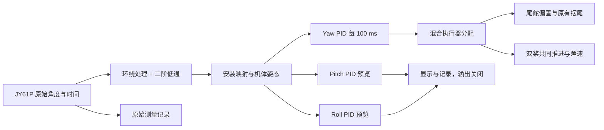

# 三轴姿态与混合执行器控制

2026-10-25，固件 `2.7.1-trace-turn`：三轴 PID 已使用同一实现，**实际只接入 yaw，支持静止保持和外部航向目标**。pitch、roll仅预览。闭环在开机时关闭；本轮仅编译和静态检查，未自动烧录、运行仿真或做实鱼水测。

新增Wi-Fi `heading_target`／LoRa代码26，把PC手动调试发送的局部IMU目标（CW正）和推进百分比交给S3。默认视觉启动只观测；用户明确启动画线自动循迹后，PC复用LOS和视觉速度PID，通过Wi-Fi发送目标航向与推进量。PC不执行yaw PID，角度环仍由S3负责。S3在原100ms周期执行角度闭环，连续目标不重置积分／时钟，D排除目标阶跃；旧版仅保持当前航向的行为和原极性+1仍保留。按用户确认将参数改为2.5/0.02/0.1，纠偏范围±100%，新增±1°死区；死区内清I/D并停止主动纠偏，目标和推进保留。角度环转向分配增益1.5，作用于左右桨差动和尾舵；去掉角度环下随转向量平方额外削减前进量的处理。电机混合饱和仍会占用共同推进余量，不把指令等同于实际推力。完整坐标／零位／透视链见[视觉观测说明](vision-control.md)。

## 论文依据与实际采用的内容

读取用户指定目录 `C:/Users/rlyoulo/Desktop/++圣光机++/开源/论文` 的 11 份 PDF，筛选推进、水动力和姿态控制相关章节。下列是本工程根据论文作出的工程实现选择，并非论文已经验证了本鱼的参数。

| 来源 | 相关内容 | 本工程采用与边界 |
| --- | --- | --- |
| [Research on design, modeling, and maneuverability analysis of hybrid-driven robotic fish](<C:/Users/rlyoulo/Desktop/++圣光机++/开源/论文/01_机器鱼推进与水动力学/fmars-12-1648335.pdf>)，第 4～8 页，式 1～19 | 姿态与体轴角速度转换；附加质量、阻尼、恢复力；双桨和双胸鳍的合力／力矩 | IMU 先按安装映射到机体系，再计算独立姿态误差。yaw 共享给尾舵和双桨；pitch 采用胸鳍共同作用，roll 采用差动作用。论文胸鳍为双自由度，本鱼每侧一个舵机，不能照搬其几何系数。 |
| [Enhanced Speed and Maneuverability of a Robotic Fish via Fin-Propeller Hybrid Propulsion](<C:/Users/rlyoulo/Desktop/++圣光机++/开源/论文/01_机器鱼推进与水动力学/Enhanced_Speed_and_Maneuverability_of_a_Robotic_Fish_via_Fin-Propeller_Hybrid_Propulsion.pdf>)，第 6～7 页 | 尾鳍偏置、摆幅和螺旋桨推力对转弯半径及角速度有耦合影响 | 一个 yaw PID 生成统一转向请求，再交给混合分配器。避免分别给尾舵和双桨设置两个互相竞争的航向 PID；不复制论文中的 3 Hz 摆动、占空比或控制增益。 |
| [Numerical investigation and swimming performance evaluation on self-propelled hydrodynamics of hybrid-driven biomimetic robotic fish](<C:/Users/rlyoulo/Desktop/++圣光机++/开源/论文/01_机器鱼推进与水动力学/1-s2.0-S2468013325000737-main.pdf>)，摘要及第 3～4 节 | 尾摆与桨流之间的水动力耦合，推进效果随工作点变化 | 保留现有摆频、相位、机械限位和转向分配，先在固定水下推进工况测 yaw。没有流速、推力及惯量辨识，暂不编造自适应增益或精确力矩前馈。 |
| [CPG-Based Locomotion Control and Hydrodynamic Experiments ...](<C:/Users/rlyoulo/Desktop/++圣光机++/开源/论文/01_机器鱼推进与水动力学/biomimetics-08-00380.pdf>)，第 3～5 节 | 摆幅、频率、偏置、相位对鳍间协同及水动力的影响 | PID 调整低频姿态修正，原有摆尾发生器继续生成推进节拍，避免每次姿态修正重置摆尾相位。该论文多自由度鳍与当前结构不同，保留现有 1.5 Hz 上限。 |
| [Guidance Systems](<C:/Users/rlyoulo/Desktop/++圣光机++/开源/论文/02_AUV制导与路径跟踪/ch10-Guidance Systems.pdf>)，章节开头及参考模型部分 | 制导目标与底层姿态控制的分层，参考指令带宽应匹配闭环能力 | 当前只做局部相对航向保持，目标在开启后的有效 IMU 样本／手动转向释放时记录，静止时也保持；不扩展成位置或路径跟踪。软件二阶滤波是本工程为本次数据抖动增加的测量处理，并非把教材中的参考滤波直接当测量模型。 |
| [Super Odometry](<C:/Users/rlyoulo/Desktop/++圣光机++/开源/论文/03_定位与惯性里程计/Super_Odometry_Study/papers/02_Super_Odometry_1_0_IROS2021.pdf>)，第 2～4 页 | 以 IMU 为核心，由视觉／激光观测约束偏置 | 保留统一时钟、原始测量与状态有效性；当前没有论文所需的视觉／激光约束，不在 ESP32 上移植因子图，也不把低通说成可消除 yaw 零偏漂移。其余惯性里程计、退化检测及路径跟踪论文未直接移植。 |

## 当前实现

`AnglePid.h` 统一计算 `P = Kp·e`、`I += Ki·e·dt`、`D = Kd·wrap(e-e_prev)/dt`，每轴独立保存积分和历史。误差均按最短圆弧，半圈固定选 -180°；无角度死区。`2.6.2-yaw-range` 将 yaw 的可用修正范围放开到 ±100%，pitch／roll 预览仍为 ±20%，各自积分按对应范围限幅，同方向饱和时停止积累。D 使用测量角度形成的误差差分；重新记录目标时清空 PID，避免目标变化引入差分尖峰。

旧版 ±20% 在水中混合自由／手扶数据中形成明确瓶颈：Kp=20 的 488 条有效闭环记录中，477 条输出已达到 ±20%。调大 Kp 无法越过旧输出上限。`2.6.2` 放开范围时仍以 1/0.02/0.1 启动；随后用户要求约20°偏差达到100%，`2.6.3-yaw-kp5` 将默认Kp改为5，Ki／Kd仍为0.02／0.1。近水平、无I／D贡献时，5°→25%、10°→50%、20°→100%；实际瞬时输出还受姿态投影、I／D和200%/s变化速率影响。原有换向先过中立、机械限位、全停和IMU有效性要求保留。

`AttitudeControl.h` 在 S3 上处理安装映射、有效性、滤波、手动优先及目标记录。显式开启 yaw 后，即使没有前进目标，也会用本地 IMU 锁定航向并允许纠偏。普通零目标／松键保持同一个航向目标和 PID；手动转向优先，释放后在静止时重新记录新航向。倒退期间仍保留手动分配；失效／过期、重新开启会丢弃旧航向和积分，手动浮沉清空 pitch 预览积分。数据无效时不以滤波历史伪装成新测量。

全停同时关闭 yaw 授权并提交原有六通道中立帧；中立输出成功后也不自动恢复，需重新开启。OTA、输出恢复／故障和控制权接管继续使用原停止路径。静止关闭开关时会使原先由 PID 偏置的尾舵回中。原先“仅前进参与 PID”的限制已取消。

两个相同的一阶低通状态串联，每级当前为 4 Hz（由 3 Hz 小幅提高，减轻平滑延迟），按真实样本时间作恒定输入的精确状态更新。roll/yaw 按圆弧插值，pitch 按线性角度；同一时间戳不反复滤波，超过既有样本有效窗口的间隔重新初始化。该滤波增加延迟，不能当作静态精度提升或零偏消除；CSV 回放的采样频率低于设备侧，因此只能展示回放结果，不能替代设备实际滤波延迟测量。

闭环开关选择 `Hybrid`：同一 yaw 请求影响尾舵偏置和桨差速。保留推进分配中的转向优先、机械限位、速度限制和摆尾相位；PID 的 100 ms 更新不改变原有 20 ms 执行器分配及 50 Hz PWM。这里的百分比是归一化命令，不是实测推力或力矩，不能声称尾舵与双桨按精确力矩比例配平。

用户传感器显示极性为：左转 yaw 增大、上浮 pitch 减小、roll 增大向右翻滚。内部 FRD 机体系采用抬头 pitch 正、右转 yaw 正、右翻 roll 正，因此用户侧航向目标／误差会转换符号；同步导出名称注明 `left_deg`、`right_pct`、`body`。原始 roll 接近 ±180° 是安装表示，不当作 180° 翻滚误差；本次静置 pitch 约 6° 不自动校零。

用户最终确认原来的 PID 极性正确，反向对照版 `2.6.4-yaw-sign` 不采用。当前 `2.6.5-yaw-kp5` 保留 `kYawCommandSign=+1`，维持原始恢复方向；IMU 安装／显示、目标／误差计算、手动转向和尾舵／双桨分配方向均沿用原映射。`/motion_status` 的 `attitude_control.yaw_command_sign` 可直接回读 +1。Kp=5、Ki=0.02、Kd=0.1 与 yaw 最大 ±100% 保留。

## 配置、调参和记录

`main/config/AttitudeConfig.h` 消费全部姿态默认值：yaw 初值 `2.5 / 0.02 / 0.1`，pitch/roll 同样具备 Kp/Ki/Kd，初值尚未水测整定。`kPitchOutputEnabled=false`、`kRollOutputEnabled=false`；roll 的作用符号和 `ControlConfig.h` 鳍片差动几何保持未标定零值。以后接入 roll 前仍需水中独立验证作用方向与有效控制能力，不能只改 PID 数值。

已经运行 `2.6.2-yaw-range` 时，可直接在上位机将 Kp=5、Ki=0.02、Kd=0.1 应用并等待鱼端回读，不需要重烧才能调参；该运行期设置在重启后丢失。`2.6.3-yaw-kp5` 将 Kp=5 固化为启动默认值。

上位机只有 yaw Kp/Ki/Kd 调节和闭环开关。LoRa v2 命令 25 将三个增益用千分之一编码，范围各 0～100；开关仍用 23/24，参数和开关经现有序号／CRC／控制权仲裁。Wi-Fi 对应动作 `yaw_pid`，同样走原命令队列。单独调参数不启动或续期运动；开启闭环会授权静止纠偏，可能产生尾舵动作和双桨差速。运行期参数不写 NVS，重启恢复 config 默认值。LoRa 队列中的 PID／开关设置不被连续目标覆盖，STOP 仍优先。

`logs/yaw-pid-history.jsonl` 独立保留参数提交与设备确认，CSV 可从上位机导出；逐样本同步导出包含原始／滤波角、时间、PID 参数、目标、误差、各项、实际下发的舵机／桨命令及 pitch/roll 预览。没有位置或转速传感器时，下发命令不能称为执行器实测反馈。

默认恢复 LoRa 优先、Wi-Fi 备用。只有鱼端报告 LoRa 超过原有 3 秒健康窗口且 Wi-Fi 控制会话／遥测可用，后续新命令才从 Wi-Fi 接管；保留返回 LoRa 的中立屏障和禁止旧目标重放。运动指令无变化不按 3 秒停机，`kLeaseMs=0` 保留。显式仅 LoRa 选项仍可选，但不再是连接默认值。

## 数据与验证边界

早期 CSV 共 1,521 条／260.453 秒，首段静置约 9.622 秒。按原始指令切换行精确分段：100% 无转向前进段 yaw 变化约 -57.74°；右转命令段 -67.97°；左转命令段 +96.35°。用户后续明确测试未下水；这些姿态变化不能当作独立舵机增益、实测推力响应或水中闭环改善率。

27.545～84.349 秒缺口伴随设备 uptime 和帧计数重计，说明设备重启，CSV 无法判定复位原因。95.135、99.114、107.053 秒显示无效对应 Wi-Fi 往返约 1.18～1.26 秒，设备端 IMU 标记有效且错误计数未增长。另两条机体角留空对应约 426／477 ms 遥测延迟，超过机体控制反馈的较短有效窗口。

离线报告位于 `build/analysis/yaw-pid-20261024/report.html`，包含实测曲线、滤波对照、相同 C++ PID 的控制器回放和统计；回放不改变实测鱼体轨迹，不能据此宣称实鱼已收敛。已验证软件计算、协议、开关、优先级及界面；后续实际 yaw 水测后再整定，pitch/roll 继续不接输出。
