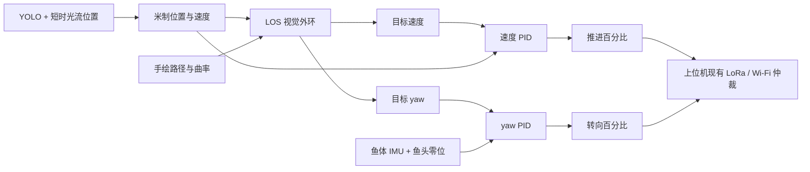

# YOLO、IMU yaw 与串级视觉循迹

视觉运行链为 `upper/vision_service.py → vision/web_runtime.py → vision_app.py`。上位机默认加载 `vision/fish_body_yolo/best.pt`；录像回放固定使用本次训练源，只做预览。实际循迹须使用实时摄像头。

## 统一角度

鱼端 `attitude_control.body_yaw_deg` 已按 IMU 安装轴映射为鱼体水平航向，字段约定为顺时针正。视觉米制坐标为 x 向右、y 向下，角度逆时针／左转正。

场地四角和实测尺寸确定相机到水池的单应变换。点击鱼头时，记录当前鱼体 IMU yaw `yaw0` 及画面中的初始鱼头世界方向 `psi0`。应让鱼静止标定，以减小图像与遥测时差。

```text
relative_yaw = wrap(yaw0 - body_yaw)
world_heading = wrap(psi0 + relative_yaw)
world_direction = (cos(world_heading), -sin(world_heading))
```

标定瞬间相对 yaw 为 0°。绿色箭头、HUD、路径误差和角度 PID 共用该航向。蓝色箭头显示目标 yaw，数字也使用同一零位。轨迹速度只用于速度反馈和位置延迟补偿，不再生成鱼头角度。移除 `position_yaw.py` 和路径内位置航向拟合分支。

遥测从上位机异步获取，不阻塞图像线程。每个设备快照携带 uptime 标识，缓存重复读取保持原观测时间，避免重复积分及 D 项时间间隔异常。过期／无效 yaw 不用位置方向替代。

## 控制结构



LOS 外环根据路径切线和有符号横向偏差生成目标航向，采用有界 `atan2` 修正。前视距离沿用 0.10–0.24 m 的自适应范围。速度目标同时受曲率、航向误差和终点距离约束，转弯减速；接近终点先减速，进入到达圈后停止，修复原有提前制动后无法进入到达圈的问题。

速度 PID 输出推进百分比，带原有速度前馈；yaw PID 输出左转为正的百分比，D 项作用在实际 yaw 上，使用环绕差和低通阻尼。两环按真实观测时间更新，重复样本不重复积分，饱和时停止向饱和方向积累。最后在通信边界将左转正转换为固件右转正，避免重复反号。

默认增益在 `vision/configs/control.json`。速度 Kp/Ki/Kd 为 60/30/4，分别对应 `%/(m/s)`、`%/m`、`%/(m/s²)`；yaw 为 50/4/8，单位 `%/rad`、`%/(rad·s)`、`%/(rad/s)`。均为初始参数，未在水中闭环整定。

启动循迹复用既有控制连接，准备仿生模式 1，并关闭鱼端独立航向保持，避免两个 yaw 控制器叠加。速度与角度 PID 在视觉进程中运行；操控页原有 Kp/Ki/Kd 仍属于鱼端独立航向保持。停止视觉后不会自动恢复那个开关。人工命令或模式改变撤销旧视觉授权，不重放旧轨迹。未改变固件的任务周期、PWM、执行器映射和 radio 帧间隔。

视觉目标最多按原有 20 Hz 发布；LoRa 仍受原有 500 ms 帧间隔约束，发布频率不等同于鱼端执行频率。现有相机延迟补偿保持 0.30 s，换相机后需重新测量。

## 使用

1. 在上位机连接控制通道，并确认 Wi-Fi 的鱼体 IMU 遥测有效。
2. 视觉页选择实时摄像头，使用默认 `best.pt`，启动识别。
3. 填写实测水池宽、高并依次选择四角。
4. 鱼静止时点击“鱼头方向”，再点头部，确认显示 `IMU yaw 0.0°`。
5. 从鱼附近绘制路径，设置巡航速度，再点击“启动循迹”。

录像回放可以检查识别和显示，不作为真实运动的位置反馈。IMU 不可用时只能预览识别，不能用位移方向启动循迹。

## 论文依据与验证边界

用户提供的 `Desktop/++圣光机++/开源/论文/02_AUV制导与路径跟踪/ch10-Guidance Systems.pdf`，PDF 第 21–22 页、正文第 261–262 页，式 (10.72)–(10.78)：切线与 LOS 横向修正、前视距离及积分解释；曲线路径部分介绍沿弧长移动参考点与 Serret–Frenet 误差。另阅齐雪等《Serret–Frenet坐标系下AUV自适应路径跟踪控制》中的虚拟参考点和视线角导航。这里采用可直接用于现有路径和 PID 的制导几何，没有复现完整反步自适应动力学，也不声称具备论文中的稳定性证明。

验证包括角度零位／±180°环绕／缓存时间、LOS 转向符号、终点接近、直线与曲线闭环简化仿真、人工接管、YOLO 与光流缺测处理，以及实际 YOLO 视频子进程和桌面／移动网页。证据在 `build/host-vision/yolo-imu/`。浏览器使用合成 IMU 和独立测试标定，未调用鱼端运动接口；没有进行真实水中循迹或 PID 整定。
